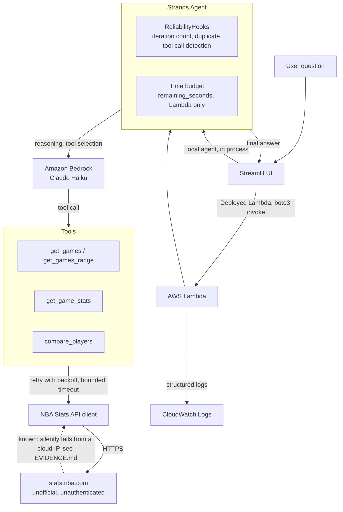

# Architecture

One request, start to finish. The same agent code runs two ways: locally inside Streamlit, or inside the deployed Lambda, called through boto3. Everything past that point is identical.

## Why it is drawn this way

Two entry points, one agent. The local path and the Lambda path never diverge once a request reaches the agent itself, which is the entire point of packaging the whole Strands agent as one Lambda instead of one Lambda per tool, see SELECTED_IMPLEMENTATION.md and EVIDENCE.md for what that choice actually looks like under failure.

The reliability layer sits between the model and the tools, not inside either one. Duplicate tool call detection and the time budget are Strands SDK hooks and a plain module level check, not something the prompt is trusted to enforce on its own.

The one arrow drawn as a dotted line is deliberate. That is the still open finding: the same request to the same external API, with the same headers, behaves differently depending on where the Lambda's network path originates. Everything else in this diagram is confirmed and stable. That one connection is the subject of the next article.
