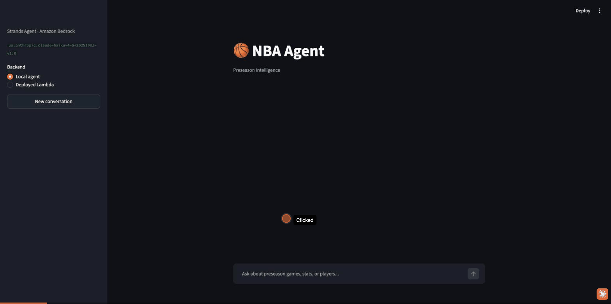
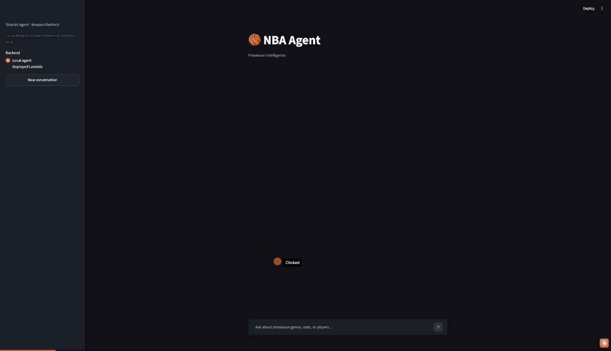
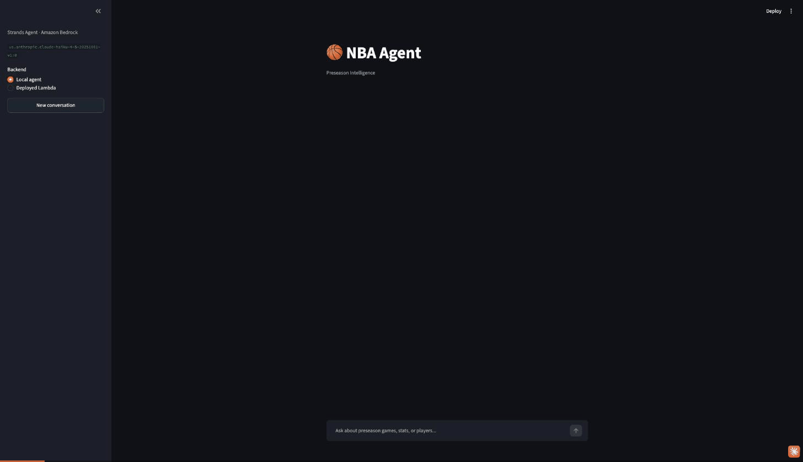

# Supporting Evidence

## Local run: works fine





Same code, same question type, run locally against the real NBA Stats API. Real data came back both times, zero failed tool calls.

Every number shown in both runs was checked directly against the raw game log data behind `compare_players`, not just trusted because the tool call succeeded. Both matched exactly, points, rebounds, assists, and minutes, game by game.

## Lambda run: the same request fails

One direct, isolated call to the NBA Stats API from inside the real deployed Lambda, bypassing the agent and Bedrock entirely:

```json
{
  "outcome": "failed",
  "exception_type": "ReadTimeout",
  "exception_message": "HTTPSConnectionPool(host='stats.nba.com', port=443): Read timed out. (read timeout=10)",
  "http_status": null,
  "elapsed_seconds": 10.05
}
```

CloudWatch's own report for that same invocation confirms it, independent of the application log:

```
REPORT RequestId: c295210b-68bd-4ec0-9bf5-7663ec8e0813
Duration: 10054.77 ms
Billed Duration: 15253 ms
Memory Size: 512 MB
Max Memory Used: 241 MB
Init Duration: 5198.21 ms
```

A `null` HTTP status means no response ever arrived at all, not an explicit block, not a timeout on our side. Same request, same headers, two different outcomes depending only on where it runs from.

## Same question, through the full agent, one environment at a time

The clearest comparison is the full agent, same exact question, asked twice, once against the local agent, once against the real deployed Lambda.




Locally, the same question returns real stats, verified above. Through the deployed Lambda, the raw CloudWatch log for that exact run shows what actually happened underneath the honest answer in the gif:

```
Tool #1: compare_players
{"tool_name": "compare_players", "arguments": {"player": "Giannis Antetokounmpo", ...}, "retry_count": 0, "status": "retrying", "error_type": "ReadTimeout"}
{"tool_name": "compare_players", "arguments": {"player": "Giannis Antetokounmpo", ...}, "retry_count": 1, "status": "retrying", "error_type": "ReadTimeout"}
{"tool_name": "compare_players", "arguments": {"player": "Giannis Antetokounmpo", ...}, "retry_count": 2, "status": "failed", "error_type": "ReadTimeout"}
I wasn't able to retrieve preseason stats for either player. The tool encountered issues fetching data for Giannis Antetokounmpo, and it ran out of time to check Klay Thompson's data.
```

```
REPORT Duration: 36557.75 ms  Billed Duration: 40875 ms  Max Memory Used: 241 MB
```

Three real, timed retry attempts on Giannis Antetokounmpo, all `ReadTimeout`. Klay Thompson was never even attempted, the time budget fix skipped him on purpose rather than let the invocation run past Lambda's own hard limit. The whole run finished in thirty six and a half seconds, comfortably inside the sixty second ceiling, with a plain, honest answer and zero invented numbers.

This is the expected result, not a bug. The same request from a cloud data center IP gets silently blocked by the same mechanism already confirmed above, while a residential IP does not. The point being demonstrated here is not that the data fetch succeeded, it is that the agent noticed it could not get real data and said so, instead of making something up. That is the actual reliability property this whole project was built to test.
