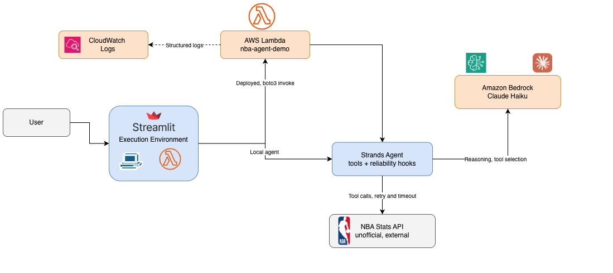

# NBA Agent Field Notes

Companion repo for an article series on transitioning from Data Engineering to AI Engineering on AWS, built around a small NBA preseason intelligence agent (Strands Agents SDK + Amazon Bedrock).

This repo is not a clone and run artifact. It holds the reasoning behind the real decisions made while building and operating the agent: what broke, why, what was tried, and what shipped. The full implementation, complete Terraform, the full system prompt, the full codebase, stays in a private lab repo and is intentionally not reproduced here.

## Architecture at a glance

The same flow, with more detail on the reliability layer, is in [docs/ARCHITECTURE.md](docs/ARCHITECTURE.md).

## Layout

- `docs/`: everything written, one topic per file.
- `media/`: every diagram, screen recording, and screenshot referenced from `docs/`.

## What is here so far

- [docs/ARCHITECTURE.md](docs/ARCHITECTURE.md): one diagram, how a question actually flows through the agent, both ways it runs, including the data-source dispatch that closed three of the four tools' exposure to a known cloud-IP failure, and where that failure still sits open for the one tool not yet migrated.
- [docs/EVALUATION.md](docs/EVALUATION.md): real evaluation runs against the deployed agent, including the finding that made moving arithmetic into code a requirement, not a preference: the same question, asked five times, answered five different ways, and three different models producing three different wrong answers on identical real data.
- [docs/PARADIGM_SHIFTS.md](docs/PARADIGM_SHIFTS.md): five real moments where a Data Engineer's instinct and the reality of a non deterministic agent reached different answers, in the order they happened.
- [docs/EVIDENCE.md](docs/EVIDENCE.md): the same real question, asked locally and through the deployed Lambda. Locally it returns real data. Through the Lambda it fails the exact same way every time, and the agent reports that honestly instead of inventing numbers. Includes real CloudWatch logs and screen recordings of both runs.
- [docs/SELECTED_IMPLEMENTATION.md](docs/SELECTED_IMPLEMENTATION.md): a handful of real code fragments, each one a direct response to a specific failure, not a general purpose toolkit.

## What is coming

More, as the next article in the series takes shape.

Work in progress.
