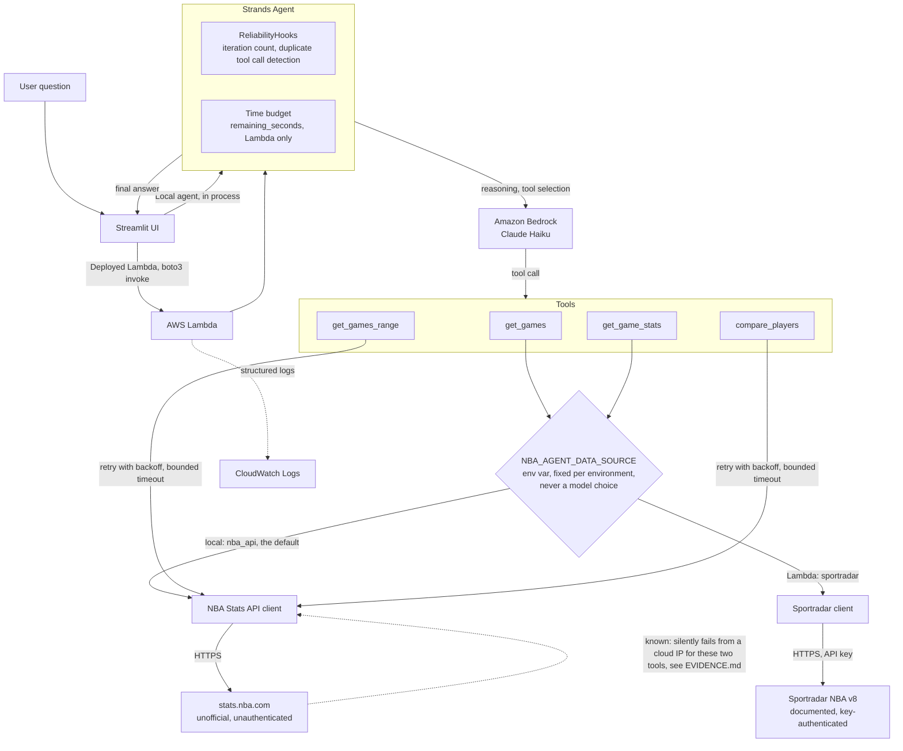

# Architecture

One request, start to finish. The same agent code runs two ways: locally inside Streamlit, or inside the deployed Lambda, called through boto3. Everything past that point is identical, including which tools exist. Which external API answers a given tool call does not have to be identical, and as of the Sportradar change below, it no longer is.

## Why it is drawn this way

Two entry points, one agent. The local path and the Lambda path never diverge once a request reaches the agent itself, which is the entire point of packaging the whole Strands agent as one Lambda instead of one Lambda per tool, see SELECTED_IMPLEMENTATION.md and EVIDENCE.md for what that choice actually looks like under failure.

The reliability layer sits between the model and the tools, not inside either one. Duplicate tool call detection and the time budget are Strands SDK hooks and a plain module level check, not something the prompt is trusted to enforce on its own.

`get_games` and `get_game_stats` now sit in front of a dispatch point instead of a single fixed client. Which API actually answers the call is read once from an environment variable, set per deployment, not asked of the model and not decided per request. The tool's name, arguments, and return shape are identical either way, so nothing upstream of that dispatch point, the agent, the prompt, the hooks, needs to know two APIs exist. This is also why the box is drawn as a decision diamond rather than another tool: it is infrastructure, not reasoning.

`get_games_range` and `compare_players` still go straight to the NBA Stats API client, unchanged. The dotted line is deliberate and now scoped down rather than removed: the same request to the same external API, with the same headers, still behaves differently from a cloud IP for exactly these two tools, the ones not yet migrated. Everything else in this diagram, including the Sportradar path, is confirmed working against the real deployed Lambda, not just locally.
